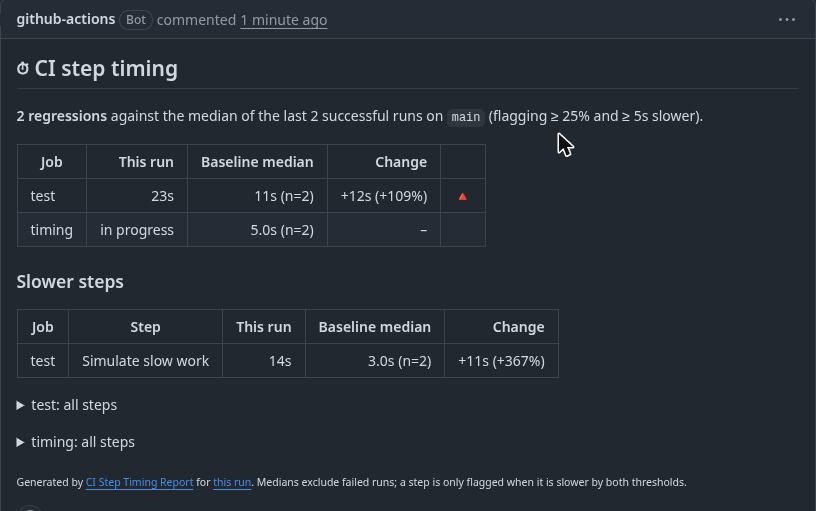

# CI Step Timing Report

A GitHub Action that compares every job and step in the current workflow run against the **median of recent successful runs** on your default branch, then writes the comparison to the job summary and (on pull requests) to a single, self-updating PR comment.

It answers "did this PR make CI slower, and where?" without a dashboard, a SaaS account, or any infrastructure. Zero dependencies; it only calls the GitHub REST API you already have a token for.




## Usage

Add a final job that waits for the rest:

```yaml
permissions:
  actions: read
  pull-requests: write   # only needed for the PR comment

jobs:
  build:
    runs-on: ubuntu-latest
    steps:
      - uses: actions/checkout@v4
      - run: npm ci
      - run: npm test

  timing:
    runs-on: ubuntu-latest
    needs: [build]        # list every job you want compared
    if: always()
    steps:
      - uses: Huckcity/step-timing@v1
```

Or put it as the last step of a single-job workflow; the steps that already finished in that job are compared and the job itself is shown as "in progress".

## What it flags

A job or step is marked 🔺 when it is slower than the baseline median by **both** `threshold-percent` and `threshold-seconds` (defaults 25% and 10s). Requiring both avoids noise from 2-second steps that doubled. 🔻 marks the same thresholds in the other direction.

The baseline is the last `baseline-runs` (default 10) successful runs of the same workflow on `baseline-branch` (default: the repository default branch). Jobs and steps are matched by name, so matrix jobs compare like for like. Failed runs never pollute the baseline.

## Inputs

| Input | Default | Meaning |
|---|---|---|
| `token` | `github.token` | Needs `actions: read`; `pull-requests: write` to comment. |
| `baseline-runs` | `10` | How many recent successful runs form the baseline (max 50). |
| `baseline-branch` | default branch | Branch whose runs form the baseline. |
| `threshold-percent` | `25` | Minimum slowdown, in percent, to flag. |
| `threshold-seconds` | `10` | Minimum slowdown, in seconds, to flag. |
| `comment-on-pr` | `true` | Post and keep updating one PR comment. |
| `fail-on-regression` | `false` | Fail the step if anything is flagged. Use with a generous threshold. |
| `exclude-jobs` | | Comma-separated job names or `prefix*` patterns to skip. |

## Outputs

`regressions` (count), `total-seconds`, `baseline-seconds`, `report-path` (Markdown file). Example gate:

```yaml
      - uses: Huckcity/step-timing@v1
        id: timing
        with:
          threshold-percent: 50
          threshold-seconds: 60
          fail-on-regression: true
```

## Notes

- The first runs on a new workflow report "no baseline yet". After one successful run on the default branch, comparisons start.
- API cost is `baseline-runs + 3` requests per run, well inside the 1,000/hour `GITHUB_TOKEN` budget.
- Re-run attempts use the latest attempt's jobs.
- Works on GitHub Enterprise Server (uses `GITHUB_API_URL`).

## Support

Free and MIT licensed. If it saves you time, [sponsor the maintainer](https://github.com/sponsors/Huckcity). For CI performance work on a whole estate (Jenkins or Actions), email adam.p.gibbons@gmail.com.

## Related

[CI Cost Report](https://github.com/marketplace/actions/ci-cost-report) prices every workflow run at GitHub per-minute rates and shows where the money goes; this action shows where the time goes. [Skip Unchanged](https://github.com/marketplace/actions/skip-unchanged) stops nightly schedules rebuilding commits that already passed.
